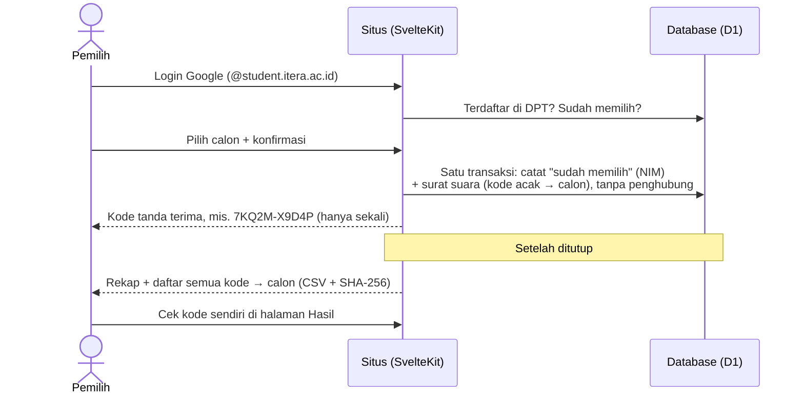

<div align="center">


# Pemira PMK ITERA 2027

**E-voting terbuka untuk Pemilihan Ketua Persekutuan Mahasiswa Kristen ITERA.**<br>
Kode sumbernya publik supaya siapa pun bisa mengaudit cara suara dicatat dan dihitung.

[](https://github.com/Persekutuan-Mahasiswa-Kristen-ITERA/pemira-pmk-2026/actions/workflows/ci.yml)


-003B57?logo=sqlite&logoColor=white>)


[**pemira.pmkitera.web.id**](https://pemira.pmkitera.web.id) ·
[Verifikasi hasil](#-verifikasi-hasil) ·
[Panduan panitia](docs/panduan-panitia.md) ·
[Panduan developer](docs/developer.md)

</div>

---

## ✨ Prinsip

| Prinsip                      | Penerapan                                                                                                                       |
| ---------------------------- | ------------------------------------------------------------------------------------------------------------------------------- |
| 🎓 **Hanya pemilih sah**     | Login Google dengan email `nama.nim@student.itera.ac.id`; NIM di email harus terdaftar di DPT (mahasiswa Kristen aktif).        |
| ☝️ **Satu orang satu suara** | Setiap NIM hanya bisa tercatat sekali; penanda "sudah memilih" dan surat suara disimpan dalam satu transaksi.                   |
| 🤫 **Rahasia**               | Identitas (`voted`) dan isi suara (`ballots`) disimpan terpisah tanpa penghubung, tanpa timestamp, tanpa urutan.                |
| 🔍 **Bisa diverifikasi**     | Setiap pemilih mendapat kode tanda terima acak. Setelah ditutup, daftar `kode → calon` dipublikasikan untuk dicek dan dihitung. |
| 🔒 **Tidak bisa diubah**     | Surat suara, penanda sudah memilih, dan audit log tidak bisa diubah/dihapus. DPT, calon, dan jadwal terkunci saat dibuka.       |

> [!IMPORTANT]
> Aturan-aturan ini ditegakkan **di database** lewat trigger SQL, bukan hanya di kode aplikasi.
> Lihat [`migrations/`](migrations/) (dimulai dari [`0001_init.sql`](migrations/0001_init.sql)) dan tesnya di
> [`src/lib/server/db/schema.spec.ts`](src/lib/server/db/schema.spec.ts).

## 🗳️ Cara kerja



Tabel `voted` hanya tahu **siapa** yang sudah memilih. Tabel `ballots` hanya tahu **kode → calon**. Tidak ada
kolom, waktu, atau urutan yang menghubungkan keduanya.

## 👥 Siapa bisa apa

| Peran                                  | Bisa                                                                                                  | Tidak bisa                                                                                                                 |
| -------------------------------------- | ----------------------------------------------------------------------------------------------------- | -------------------------------------------------------------------------------------------------------------------------- |
| **Publik**                             | Melihat calon, jadwal, dan angka partisipasi. Setelah ditutup: hasil, daftar surat suara, cek kode.   | Melihat hasil sebelum pemungutan suara ditutup.                                                                            |
| **Pemilih** (NIM terdaftar di DPT)     | Memilih satu kali dan menerima kode tanda terima.                                                     | Memilih dua kali atau mengubah pilihan.                                                                                    |
| **Admin** (diundang super admin)       | Mengatur jadwal, calon dan foto, serta DPT sebelum pemungutan suara dibuka; tutup darurat; audit log. | Melihat pilihan siapa pun, melihat siapa yang sudah atau belum memilih (hanya jumlahnya), mengubah suara, membuka kembali. |
| **Super admin** (`SUPER_ADMIN_EMAILS`) | Semua yang bisa dilakukan admin, ditambah mengundang dan mencabut admin.                              | Sama dengan admin.                                                                                                         |

Semua tindakan admin tercatat di audit log yang tidak bisa diubah atau dihapus.

## 🔍 Verifikasi hasil

Setelah pemungutan suara ditutup, halaman `/hasil` menampilkan perolehan suara, pencarian kode tanda terima,
dan berkas CSV berisi semua surat suara (`kode,nomor_calon`) beserta hash SHA-256-nya. Pemilih tidak wajib
memeriksa apa pun; langkah berikut disediakan untuk saat ada sengketa hasil. Siapa pun bisa:

1. **Mencocokkan hash** berkas CSV:
   ```sh
   shasum -a 256 surat-suara-pemira-pmk-itera-2027.csv        # macOS / Linux
   certutil -hashfile surat-suara-pemira-pmk-itera-2027.csv SHA256   # Windows
   ```
2. **Menghitung ulang** perolehan suara dari CSV tersebut.
3. **Memastikan kode tanda terimanya sendiri** ada di daftar dengan nomor calon yang benar.
4. **Mencocokkan versi**: commit yang tampil di footer situs bisa dibandingkan dengan kode di repo ini.
5. **Mencocokkan DPT**: panitia mengumumkan sidik jari (SHA-256) DPT saat DPT dikunci; angka yang sama tampil
   di panel admin dan berubah jika DPT diubah sedikit saja.

> [!NOTE]
> Situs resmi hanya [pemira.pmkitera.web.id](https://pemira.pmkitera.web.id). Situs uji coba (staging)
> memakai database terpisah dan selalu ditandai pita kuning bertuliskan **"Situs uji coba"**; footer setiap
> situs menyebut database yang dipakai.

## ⚠️ Batasan yang diketahui

Kami mencantumkan batasan sistem secara terbuka:

- **E-voting jarak jauh** tidak bisa mencegah pemilih ditekan atau diawasi saat memilih, atau meminjamkan
  akunnya. Hal ini diatur lewat tata tertib panitia.
- **Kode tanda terima** bisa dipakai pemilih untuk menunjukkan pilihannya kepada orang lain. Meminta kode
  tanda terima orang lain dilarang oleh tata tertib.
- **Siapa yang sudah memilih** tidak ditampilkan di web, termasuk kepada admin. Orang yang memegang akses
  langsung ke database (pengelola akun Cloudflare) masih bisa melihat NIM yang sudah memilih, tetapi tidak
  pilihannya, karena surat suara disimpan terpisah tanpa NIM.

## 📋 Untuk panitia

Langkah persiapan, simulasi, hari pemilihan, dan rekapitulasi ada di
[`docs/panduan-panitia.md`](docs/panduan-panitia.md).

## 🛠️ Untuk developer

Arsitektur, aturan yang wajib dijaga (terutama kerahasiaan suara), lingkungan, dan alur kerja ada di
[`docs/developer.md`](docs/developer.md).

<a id="menjalankan-lokal"></a>

<details>
<summary><b>Menjalankan lokal</b></summary>

Prasyarat: Node.js 22.13+ (untuk `node:sqlite` di tes) dan [pnpm](https://pnpm.io).

```sh
pnpm install
cp .dev.vars.example .dev.vars   # secret lokal, tidak di-commit
# Edit .dev.vars: isi SUPER_ADMIN_EMAILS dengan email Google-mu sendiri supaya bisa membuka /admin.
pnpm db:reset:local              # buat database lokal + jalankan migrasi
pnpm db:seed:local               # opsional: data contoh (fiktif) dan buka jendela pemilihan 7 hari
pnpm dev                         # http://localhost:5173
```

Login Google berjalan di `localhost` tanpa akses ke Cloudflare atau Firebase. Masuk lewat **"Masuk dengan
akun panitia"** untuk membuka panel admin. Untuk mencoba memilih, tambahkan NIM akun mahasiswamu ke DPT lokal
(lihat `scripts/seed-dev.sql`).

</details>

<details>
<summary><b>Perintah</b></summary>

| Perintah                | Fungsi                                                             |
| ----------------------- | ------------------------------------------------------------------ |
| `pnpm dev`              | Server pengembangan                                                |
| `pnpm test`             | Tes unit, termasuk tes aturan database                             |
| `pnpm check`            | Pemeriksaan tipe                                                   |
| `pnpm lint`             | Prettier + ESLint                                                  |
| `pnpm build`            | Build untuk Cloudflare Pages                                       |
| `pnpm preview`          | Jalankan hasil build secara lokal dengan runtime Cloudflare        |
| `pnpm gen`              | Buat ulang tipe Cloudflare setelah mengubah `wrangler.jsonc`       |
| `pnpm db:reset:local`   | Hapus dan buat ulang database D1 lokal                             |
| `pnpm db:seed:local`    | Isi database lokal dengan data contoh                              |
| `pnpm db:reset:staging` | Kosongkan database **staging** (untuk simulasi). Bukan production. |

</details>

<details>
<summary><b>Struktur</b></summary>

```
migrations/          Skema D1 + aturan (trigger) pemilihan, satu berkas per perubahan
scripts/seed-dev.sql Data contoh untuk pengembangan lokal
src/app.css          Token desain (palet, tipografi) dan gaya global
src/lib/components/  Komponen tampilan: surat suara, stempel, hitung mundur, guilloche
src/lib/server/      Kode yang hanya berjalan di server (akses database, logika pemilihan)
src/routes/          Halaman: beranda, /masuk, /pilih (surat suara), /hasil, /admin, /foto-calon, /keluar
docs/                Panduan panitia dan developer
wrangler.jsonc       Konfigurasi Cloudflare Pages, binding D1, dan APP_ENV (production & preview)
```

</details>

### Deploy

Deploy hanya lewat GitHub Actions ([`.github/workflows/deploy.yml`](.github/workflows/deploy.yml)), supaya
versi yang berjalan selalu sama dengan commit yang tampil di footer situs:

- **Production**: push tag `v*`, misalnya `git tag v1.0.0 && git push origin v1.0.0`.
- **Staging**: jalankan workflow _Deploy_ secara manual dari tab Actions (atau `pnpm deploy:staging`).
  Staging memakai database terpisah dan tersedia di `https://staging.pemira-pmk-itera.pages.dev`.

Workflow membutuhkan secret repo `CLOUDFLARE_API_TOKEN` (izin Cloudflare Pages Edit + D1 Edit) dan
`CLOUDFLARE_ACCOUNT_ID`.

### Teknologi

- [SvelteKit](https://svelte.dev/docs/kit) di [Cloudflare Pages](https://developers.cloudflare.com/pages/)
  (dipilih karena mendukung subdomain lewat CNAME di DNS luar)
- [Cloudflare D1](https://developers.cloudflare.com/d1/) (SQLite) sebagai database
- [Firebase Authentication](https://firebase.google.com/docs/auth) untuk login Google; token diverifikasi
  di server dengan [jose](https://github.com/panva/jose)

## 🔐 Data pribadi dan secret

> [!CAUTION]
> Repo ini publik. **Jangan pernah meng-commit** daftar pemilih (DPT), file `.dev.vars`, atau kredensial
> apa pun. DPT diimpor panitia lewat **Admin → DPT** langsung ke D1; secret diatur dengan
> `wrangler pages secret put`.

Menemukan celah keamanan? Laporkan secara pribadi kepada pengurus PMK ITERA atau pembina, jangan lewat
issue publik, supaya bisa diperbaiki sebelum diketahui luas.

---

<div align="center">
<sub>Dibuat oleh dan untuk Persekutuan Mahasiswa Kristen ITERA.</sub>
</div>
